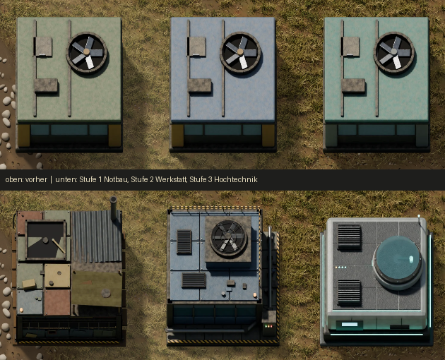
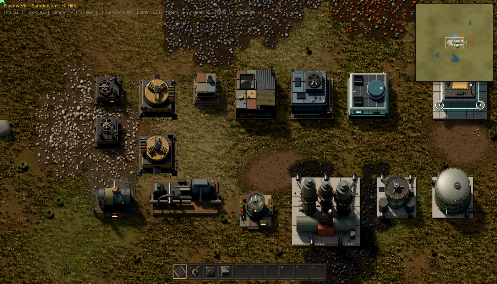
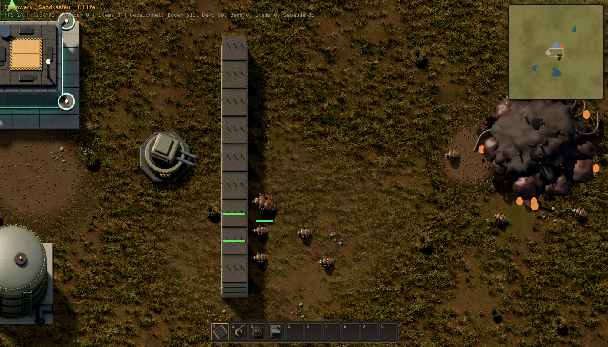

# Stilbibel „Endzeit-Industrie“

Ziel: Gebäude sollen wie echte, benutzte Industrie wirken – dicht im Detail, gedeckt in der Farbe, glaubwürdig
zusammengebaut – statt wie glatte Klötze. Erzählung: Die Zukunft nach dem Zusammenbruch. Man beginnt mit dem,
was herumliegt, und baut sich Schritt für Schritt zurück zur Hochtechnik. **Je weiter man kommt, desto besser
sehen die Gebäude aus.** Eigene Formen, keine fremden Grafiken als Vorlage.

## Drei Ausbaustufen

| Stufe | Name | Erkennbar an | Farbe | Verschleiß |
|---|---|---|---|---|
| 1 | Notbau | Flickenbleche in verschiedenen Fremdfarben, Wellblech, Plane, Holzbohlen, Seile, Bewehrungsstahl, schiefe Platten, Abgasrohr mit Ruß | rostbraun, verblichenes Oliv/Ocker, Graublau | stark: Rost, Laufspuren, Staub |
| 2 | Werkstatt | genormte, lackierte Paneele mit Fugen und Rippen, Nieten, Warnstreifen, Geländer, Lüftungsgitter, Leitern, Rohrleitungen mit Halterungen, Schaltschrank mit LEDs | eine Erkennungsfarbe je Gebäude auf dem Dach (gedeckt), Rahmen dunkel | mittel: Kantenabrieb, etwas Rost |
| 3 | Hochtechnik | glatte, gefaste Verbundpaneele, feine Fugen, Kühlrippen, Glasluken, Leuchtstreifen (Cyan), Displays | Hellgrau + Graphit, Akzent Petrol | gering: feiner Staub |

Zuordnung (Stand des Spiels):

- **Stufe 1:** Brennstoffbohrer, Steinofen, Brennstoff-Greifarm, Holz-/Eisenkiste, gelbes Band, Kessel, Dampfmaschine,
  Wasserpumpe, kleiner Mast, Rohr, Montagemaschine 1, Labor.
- **Stufe 2:** Elektrischer Bohrer, Montagemaschine 2, Stahlofen, Greifarme (normal/schnell/lang), schnelles Band,
  Splitter, Pumpe, Tank, Ölpumpe, Raffinerie, Chemiefabrik, mittlerer/großer Mast, Umspannwerk, Lampe, Stahlkiste,
  Solarpanel, Akku, Radar, Gleise/Züge, Kombinatoren.
- **Stufe 3:** Montagemaschine 3, Elektroofen, Leuchtfeuer, Roboterhangar, Roboter, Logistikkisten, Expressband,
  Raketensilo, Landeplatz.

## Regeln für Modelle

1. **Draufsicht zählt.** Die Kamera (30° Neigung) zeigt vor allem Dach und Südseite. Das Dach braucht die meiste Arbeit.
2. **Höhen staffeln statt Würfel.** Sockel/Deck → Halle → Aufbau (Lüfterturm, Luke, Schornstein). Versetzte
   Volumen werfen Schatten in die eigene Grundfläche; das gibt Tiefe.
3. **Detaildichte:** auf jedem Feld mindestens 3–5 erkennbare Kleinteile (Fugen, Schrauben, Gitter, Kästen, Kabel).
   Kleinste sinnvolle Größe ≈ 0,03 Feld (SD: 2 px).
4. **Flächen brechen:** keine glatte Fläche größer als ~0,8 × 0,8 Feld ohne Fuge, Platte oder Teil darauf.
5. **Gedeckte Farben, wenige Akzente:** Leuchtfarben nur für Lampen/Status (Stufe 2 Bernstein, Stufe 3 Cyan).
6. **Verwitterung nach Stufe** (Material `bauten.weathered`): Rost/Laufspuren/Staub nehmen von Stufe 1 nach 3 ab.
7. **Bewegung zeigen:** Lüfter, Kurbel, Greifer oder Ring dreht sich in der Arbeitsanimation (8 Frames).
8. **Anschlüsse sichtbar:** Kabel zum Mast, Rohrstutzen, Ausgaberutsche – zeigt, wie das Gebäude ins Netz passt.

## Baukasten

`assets/blender/lib/kit.py`:

- `Tier(level, accent)` – Materialsatz je Stufe (Rahmen, Paneele, Metall, Akzent, Warnstreifen, Glas, Plane, Holz).
- `paneled_top` (Platten mit Fugen, optional Flicken/Schrauben/Schiefstand), `wall_panels` (Wandpaneele mit Rippen),
  `corrugated` (Wellblech/Plane), `patch`, `grille` (Lüftungsgitter), `fan` (Lüfter mit Schutzgitter),
  `railing`, `ladder`, `cable`, `pipe_run`, `ibeam`, `beacon_light`, `light_strip`, `greebles` (Kleinteile).

Pilot: Montagemaschinen 1–3 in `assets/blender/lib/stufen.py` (gerendert von `models/montage.py`).
Stufe 1: `assets/blender/lib/stufe1.py` (Bohrer, Kessel, Labor neu; Dampfmaschine, Uferpumpe, Ofen über `T1Mats`
– bestehende Modelle mit Stufe-1-Materialien – plus Zusatzdetails).

## Anregungen (nur Prinzipien, keine Vorlagen)

- Verschleiß folgt der Form: Kanten blank gescheuert, Vertiefungen verschmutzt, nicht überall gleich stark
  (Prinzip Kantenabrieb über Krümmung, Schmutz über Umgebungsverdeckung).
- Verlassene Industrieanlagen, Behelfsbauten aus Container- und Wellblech, Werkstatt-Ästhetik (Dieselpunk) als
  Stimmung; je weiter das Spiel, desto „sauberer“ und technischer.

## Licht und Farbe (ganzes Bild)

Farbabstimmung im Spiel (`src/data/look.ts`, Filter in `src/render/look.ts`, abschaltbar mit `?look=0`):

- **Boden** (Gras, Wasser, Erze, Decals) dunkler (×0,8), mehr Kontrast, neutral → Gebäude und Bänder stehen davor.
- **Ganzes Bild** etwas mehr Kontrast, warme Lichter, leicht kühle Schatten (Split-Toning).
- **Schlagschatten** kräftiger (Deckkraft 0,74 statt 0,5).
- **Großflächige Bodenschattierung**: Flecken von ~22 und ~7 Feldern Größe, ±13 % bzw. ±6 % Helligkeit
  (`LOOK.macro`, `src/render/biome.ts`), damit die Wiese aus der Entfernung nicht gleichförmig wirkt.

## Stand nach dem Gesamtrender

Sonne 40° (`eisen.SUN_ELEVATION`), Schattenleinwände wachsen nach Südosten (`eisen.SHADOW_GROW`), automatischer
Detail-Durchgang für Stufe 2/3 (`kit.detail_pass`, `anlagen.building(..., tier=)`), Bohrer `lib/bohrer.py`,
Gegner `lib/kampf.py`.

